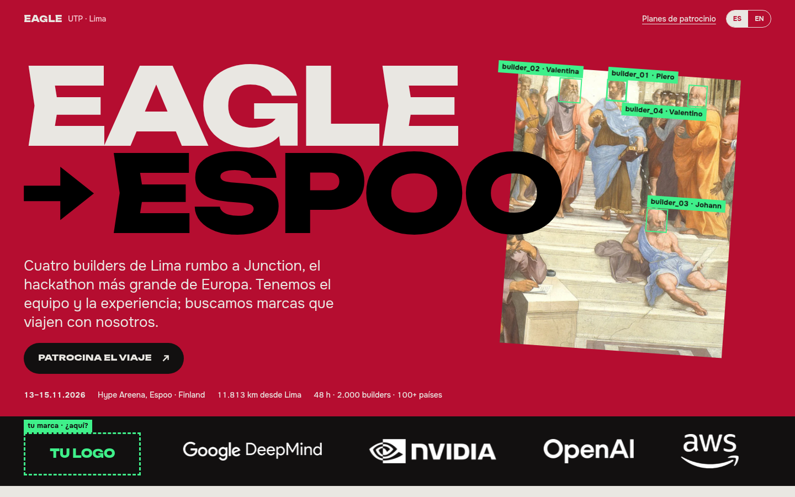
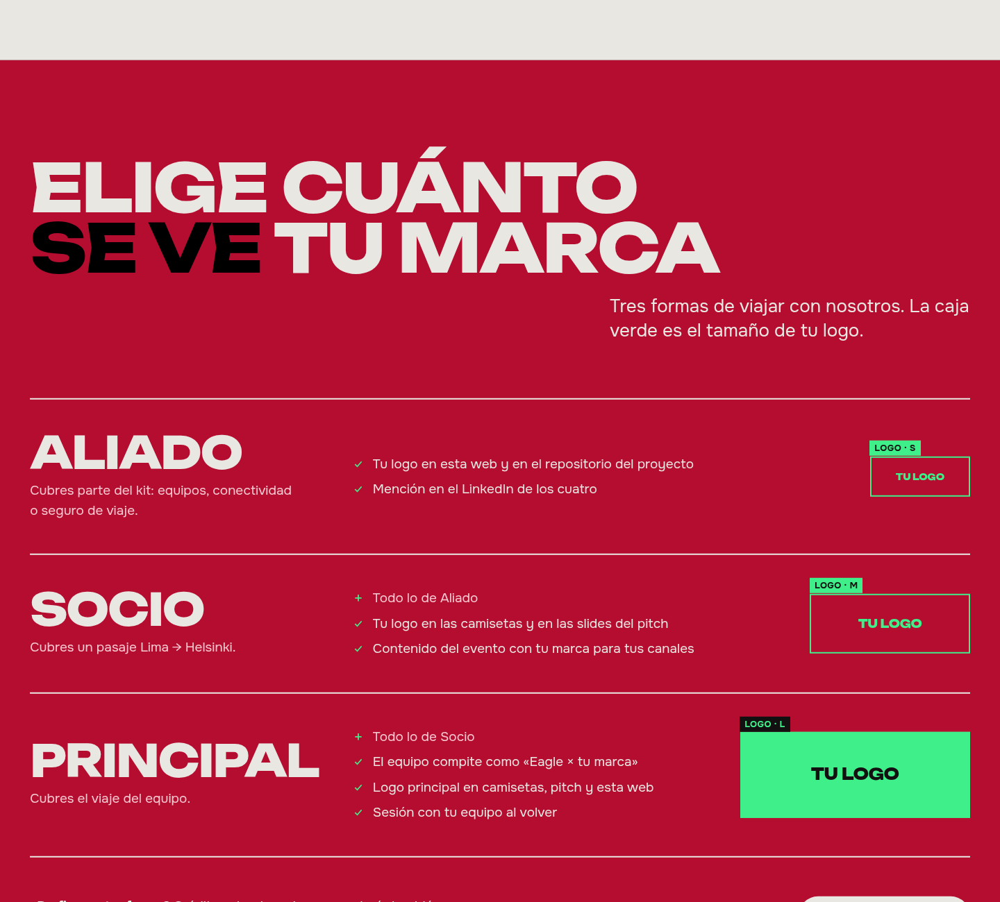
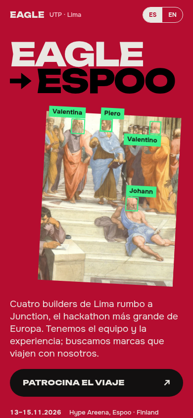

<div align="center">

# EAGLE × TU MARCA

**Cuatro builders de Lima rumbo a Junction 2026, el hackathon más grande de Europa. Buscamos marcas que viajen con nosotros.**<br>
<sub>Four builders from Lima heading to Junction 2026, Europe's biggest hackathon. We're looking for brands to travel with us · 13–15.11.2026 · Hype Areena, Espoo, Finland</sub>

<br>



<br>

**[Ver la web →](https://eagle-sponsors.vercel.app)**<br><br>

[Planes](#planes) · [Equipo](#el-equipo) · [Correr en local](#correr-en-local) · [Deploy](#deploy) · [Versión UTP](https://github.com/piales00/eagle-junction-2026)

</div>

---

## La idea

Es la edición para patrocinadores de [eagle-junction-2026](https://github.com/piales00/eagle-junction-2026). Aquella le habla a la UTP; esta, a cualquier empresa que quiera poner su marca en Junction junto a un equipo que ya entrega.

Conserva el mismo lenguaje: pinturas del Renacimiento escaneadas por un "detector" de visión por computadora, el carmesí de póster y tipografía pesada. Lo que cambia es el pedido. En la primera pantalla, junto a Google DeepMind, NVIDIA, OpenAI y AWS, hay un espacio vacío marcado **TU LOGO**.

| | |
| :-- | :-- |
| **Para quién** | Empresas y marcas: marketing, employer branding, proveedores cloud y tech |
| **Qué pide** | Patrocinio del viaje a Junction 2026 (Espoo, Finlandia), con dinero o en especie |
| **Qué ofrece** | Logo en camisetas, pitch, repositorio y web, contenido para sus canales y una sesión con su equipo al volver |
| **Idiomas** | Español / English, con un selector en la cabecera |

## Planes



| Plan | Qué cubre | Qué recibe la marca |
| :-- | :-- | :-- |
| **Aliado** | Parte del kit: equipos, conectividad o seguro | Logo en la web y en el repo, y mención en el LinkedIn de los cuatro |
| **Socio** | Un pasaje Lima → Helsinki | Lo de Aliado, más logo en camisetas y en el pitch, y contenido con su marca |
| **Principal** | El viaje del equipo | Lo de Socio, más competir como «Eagle × tu marca», logo principal y una sesión con su equipo |

Los montos no están en la web: van en el dossier que enviamos por correo. También aceptamos créditos cloud, equipos o mentoría.

## El equipo

| | Rol | |
| :-- | :-- | :-- |
| **Piero Pérez** | Backend · Multi-agent AI | [LinkedIn](https://www.linkedin.com/in/piero-perez-izquierdo/) · [GitHub](https://github.com/piales00) |
| **Valentina Ayerve** | Agile · Data · IA | [LinkedIn](https://www.linkedin.com/in/valentina-ayerve-devcode) |
| **Johann Diaz** | Data · Business Intelligence | [LinkedIn](https://www.linkedin.com/in/johann-diaz-96137a2a9) |
| **Valentino Llamocca** | Product · Estrategia | [LinkedIn](https://www.linkedin.com/in/valentino-llamocca-barraza-9a279a315) |

Tres becas de excelencia académica UTP, los cuatro en LEAD UTP y un **Top 2 en Stellar Odyssey Perú 2026** con [Masi](https://masiapp.vercel.app).

<div align="center">

</div>

## Qué hay dentro

```
.
├── index.html        # toda la página: HTML, CSS y JS sin dependencias
├── PRODUCT.md        # a quién le habla la web y qué puede prometer
├── favicon.svg
├── img/              # pinturas, retratos, logos de partners y empresas
├── docs/             # capturas para este README
└── vercel.json       # URLs limpias y caché larga para /img
```

- **Sin build ni frameworks.** Es un único `index.html`. Las fuentes vienen de Google Fonts (Unbounded y Onest).
- **El tamaño del logo es el argumento.** En cada plan, la caja verde muestra cuánto espacio ocupa la marca. Se llena al pasar el mouse o, en el celular, al cruzar el centro de la pantalla.
- **Pensada para el celular.** Sin *hover* en pantallas táctiles, las fotos, los logos y los planes reaccionan al scroll. Todo respeta `prefers-reduced-motion`.

## Correr en local

```bash
git clone https://github.com/piales00/eagle-sponsors.git
cd eagle-sponsors
python3 -m http.server 8000   # luego abre http://localhost:8000
```

## Deploy

Es un sitio estático, así que Vercel lo sirve tal cual:

```bash
npx vercel --prod
```

## Créditos

- **Obras de dominio público** (Wikimedia Commons): Rafael, *La Escuela de Atenas*; Miguel Ángel, *La creación de Adán*; Botticelli, *El nacimiento de Venus*.
- **Inspiración visual:** [2026.hackjunction.com](https://2026.hackjunction.com/).
- **Logos:** los de los partners vienen de la web de Junction 2026 y son de sus dueños. Patrocinan el evento, no a este equipo. Los logos de la UTP, BCP, Interseguro, Tecsur y Diesel Autopartes del Perú se usan solo como referencia.

<div align="center">
<br>
<sub>Hecho en Lima, rumbo a Espoo · 11.813 km</sub>
</div>
